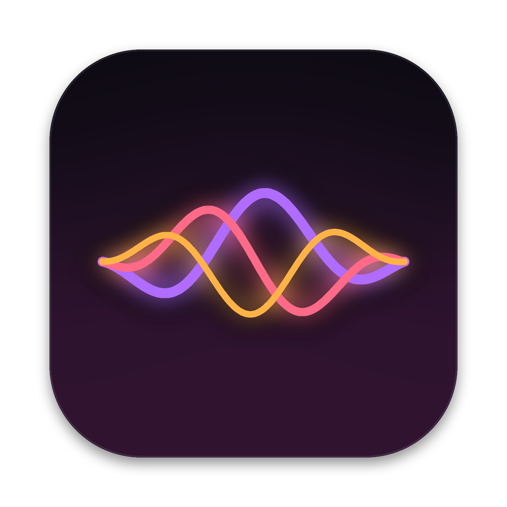

<p align="center"></p>
<h1 align="center">Wavelength</h1>
<p align="center">Your own Mac assistant, on your wavelength. Private to our team.</p>

Press a shortcut, say what you need, and your assistant gets it done: opens apps, arranges windows, plays music,
answers questions about what's on your screen. You choose its name (Zuka, Nova, anything) and what it calls you.

## Features

- **Your own assistant.** You name it and choose what it calls you; the app is Wavelength.
- **Listening capsule.** A small dark capsule at the top of the screen with a moving voice ribbon. No big window, no text while you talk. It grows into a compact card only to answer.
- **Greetings.** It says hello by time of day ("Good morning, Sam. All systems are up.") and then listens.
- **Natural voice (optional).** Runs on your Mac and works offline once downloaded. Moods follow the line: upbeat for good news, calm for problems. Or use the free Mac voice.
- **Works offline.** Opening apps, moving windows, playing music and your shortcuts need no internet or AI. Offline, it tells you what still works.
- **Usage check.** Before anything that would use your Claude plan, it asks. Free commands never ask.
- **Credit block.** Paid creative tools (Atria, Higgsfield) are blocked, so credits are never spent by accident.
- **Check-ins.** A short spoken hello a few times on weekdays, only when you're at your Mac and not on a call.
- **Private by default.** No telemetry, no background updates.

## What you need

- A Mac with macOS 26 or newer (8 GB works; 16 GB is best for the natural voice)
- [Claude Code](https://claude.com/claude-code), signed in to your Claude plan
- An invite to this private repo, and about 4 GB free if you want the natural voice

## Install

Open Claude Code and paste:

```
Set up my own copy of this Mac assistant from https://github.com/zukkaafckr/wavelength. Clone it, read its CLAUDE.md first and follow it exactly: before doing anything, ask me my assistant's name, what it should call me, which Mac and how much memory I have, and which voice I want.
```

Claude asks four questions, then installs, records your greetings in the voice, and walks you through the permissions.

## Licence

Wavelength's additions are private to the team: see LICENSE-WAVELENGTH. It is built on Atticus by SaarthurR,
whose code stays under the MIT License (LICENSE, NOTICE).
